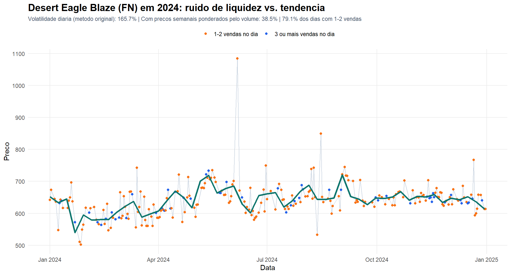
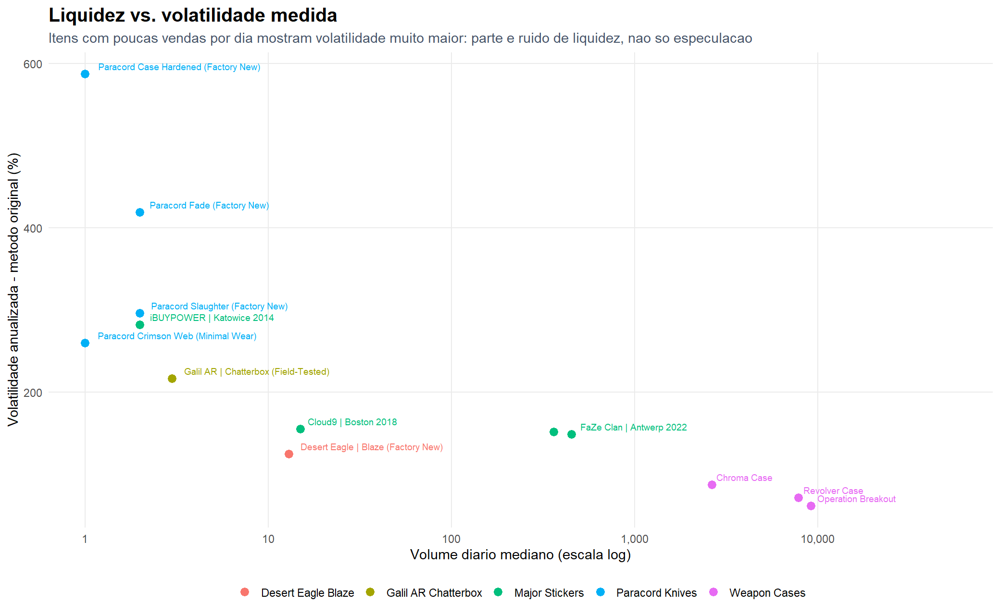
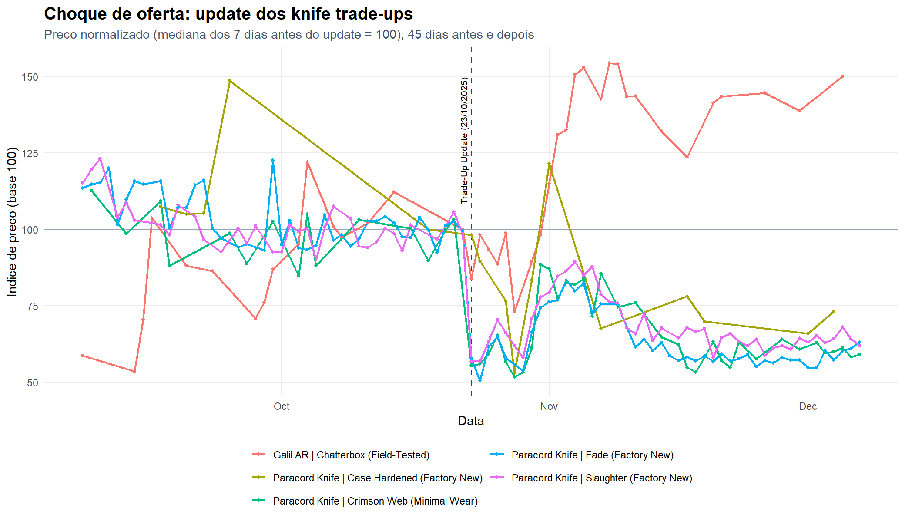

# Análise de robustez

Esta pasta revê a análise original do trabalho *"O poder de mercado da Valve nas skins do Counter-Strike 2"* com quatro melhorias:

1. **Limpeza dos dados** antes de medir a volatilidade (outliers, dados horários, dias sem vendas).
2. **Métricas de liquidez**, sugeridas na conclusão do trabalho como investigação futura.
3. **Testes estatísticos formais** em vez de apenas estatística descritiva.
4. **Estudos de evento** que quantificam os choques descritos no trabalho (update dos trade-ups, anúncio do CS2, vitórias da FaZe).

Tudo é gerado por [`analyze_robustness.R`](analyze_robustness.R), com as funções em [`../R/steam_helpers.R`](../R/steam_helpers.R). Os scripts originais de cada pasta não mudaram de método e continuam a reproduzir os gráficos e o Anexo 4 do trabalho.

## Problemas encontrados nos dados

| Problema | Exemplo | Efeito na análise original |
| --- | --- | --- |
| Vendas anómalas | Paracord Knife \| Fade (FN) vendida a **1,41** em 21/01/2025, quando valia ~300 | Intervalo de preço de 92 345 % e "maior ganho diário" de 575 % |
| Dias sem vendas | Desert Eagle Blaze em 2024: 254 observações em 366 dias (**30,6 %** dos dias sem vendas) | Retornos que cobrem 2–13 dias são tratados como diários e anualizados com `sqrt(365)` |
| Liquidez muito baixa | Desert Eagle Blaze em 2024: **79,1 %** dos dias com 1–2 vendas, volume mediano = 1 | Um único float ou sticker diferente muda o "preço do dia" e infla a volatilidade |
| Dados horários no fim da série | Nos últimos ~30 dias a Steam devolve um ponto por hora | Mistura retornos horários com diários |
| Preço preso no mínimo | Sticker da FaZe a 0,03 durante quase todo o 2024 | Uma subida para 0,04 parece +33 % |

Correções aplicadas: agregação a um preço diário ponderado pelo volume, filtro de Hampel (|desvio| > 5 MAD numa janela de ±7 observações, ver [`outliers_removed.csv`](outliers_removed.csv)), retornos divididos por `sqrt(dias entre vendas)` e uma versão com preços semanais ponderados pelo volume.

## 1. Desert Eagle Blaze em 2024 (Anexo 4 revisto)

| Indicador | Método original | Corrigido |
| --- | --- | --- |
| Volatilidade anualizada | 165,7 % | 117,0 % (sem outliers, ajustada aos dias sem vendas) |
| Volatilidade com preços semanais (VWAP) | — | **38,5 %** |
| Intervalo de preço (máx./mín. − 1) | 116,1 % | 116,1 % |
| Variação total (1.º dia → último dia de 2024) | — | **−4,4 %** |
| Teste de Jarque-Bera (normalidade) | — | p < 0,001 → caudas pesadas |
| Teste ARCH-LM (clusters de volatilidade) | — | p < 0,001 → volatilidade em clusters |

**Leitura:** a skin continua volátil, mas grande parte dos 165,7 % é ruído de liquidez: os pontos laranja (dias com 1–2 vendas) saltam à volta de uma tendência semanal (linha verde) bem mais estável. Atenção também a que os **116,05 % são o intervalo entre o mínimo e o máximo**, não a variação ao longo do ano; de janeiro a dezembro de 2024 o preço até desceu 4,4 %.

## 2. Liquidez vs. volatilidade

Nos 13 itens, a correlação de Spearman entre o volume diário mediano e a volatilidade medida é **ρ = −0,92 (p < 0,001)**. Os itens mais caros e menos transacionados (facas) parecem os mais voláteis, e as weapon cases, com milhares de vendas por dia, os menos voláteis. Ou seja, comparar volatilidades entre itens sem controlar a liquidez exagera o risco dos itens raros.

## 3. Choque de oferta: update dos knife trade-ups (23/10/2025)

Mediana do preço 30 dias antes vs. 30 dias depois (o dia do update fica de fora):

| Item | Antes | Depois | Variação | Volume (30 d) | Teste de Welch (log preço) |
| --- | --- | --- | --- | --- | --- |
| Paracord Knife \| Fade (FN) | 334,24 | 212,57 | **−36,4 %** | 64 → 733 (+1045 %) | p < 0,001 |
| Paracord Knife \| Slaughter (FN) | 279,67 | 192,17 | **−31,3 %** | 45 → 287 (+538 %) | p < 0,001 |
| Paracord Knife \| Crimson Web (MW) | 259,78 | 166,40 | **−35,9 %** | 11 → 99 (+800 %) | p < 0,001 |
| Galil AR \| Chatterbox (FT) | 137,39 | 186,08 | **+35,4 %** | 21 → 54 (+157 %) | p = 0,001 |

No próprio dia do update a Slaughter fechou 43 % abaixo da mediana da semana anterior e a Fade 42 % (−49,5 % no dia seguinte). Os dados diários não permitem medir "as primeiras horas", mas confirmam a ordem de grandeza referida no trabalho.

**Leitura económica:**

- **Facas:** o preço desce e a quantidade transacionada explode. É o padrão de um **deslocamento da curva da oferta para a direita**: a Valve criou uma nova forma de produzir facas.
- **Skins Covert (Galil Chatterbox):** o preço e o volume sobem. É uma **procura derivada**: as Covert passaram a ser *inputs* para produzir facas, por isso a sua procura subiu.
- O teste F à variância não é significativo nas facas (p > 0,1): o update mudou o **nível** do preço, não a sua volatilidade.

## 4. Choque de procura: anúncio vs. lançamento do CS2

| Item | Anúncio (22/03/2023), 30 d | Lançamento (27/09/2023), 30 d |
| --- | --- | --- |
| Chroma Case | **+87,3 %** (p < 0,001) | +8,3 % |
| Operation Breakout Weapon Case | **+44,4 %** (p < 0,001) | +2,2 % |
| Revolver Case | **+91,6 %** (p < 0,001) | +9,3 % |
| Desert Eagle \| Blaze (FN) | **+21,7 %** (p < 0,001) | +0,3 % (p = 0,85) |

**Leitura:** o grande salto acontece no **anúncio**, não no lançamento. O mercado antecipou o aumento de jogadores (expectativas), e quando o jogo saiu essa informação já estava no preço.

## 5. Esports: stickers da FaZe Clan (Antwerp 2022)

| Evento | 7 dias | 30 dias |
| --- | --- | --- |
| Vitória na ESL Pro League S17 (26/03/2023) | +82,9 % | +175 % |
| Vitória na IEM Sydney 2023 (22/10/2023) | +46,7 % | 0 % |

A IEM Sydney mostra o padrão de subida rápida seguida de correção descrito no trabalho. A vitória na ESL Pro League aconteceu **4 dias depois do anúncio do CS2**, por isso a subida de +175 % não pode ser atribuída só à FaZe (o efeito dos dois eventos está misturado). Como o sticker vale cêntimos, cada mudança de 0,01 já representa uma variação percentual grande.

## Limitações

- Os preços da Steam são medianas diárias de vendas e incluem a taxa de 15 %; não são preços de transação individuais.
- O mesmo `market_hash_name` junta floats, padrões e stickers diferentes, o que cria heterogeneidade nos itens caros.
- O estudo de evento é antes/depois, sem grupo de controlo; outros acontecimentos na mesma janela podem afetar os resultados.
- Os testes assumem observações independentes; com clusters de volatilidade (ARCH), os p-valores devem ser lidos como indicativos.

## Próximos passos sugeridos

- Comparar com um ativo de referência (S&P 500, Bitcoin) no mesmo período para dizer se 38–117 % é "alto".
- Comparar com mercados secundários (CSFloat, BitSkins), que não têm a taxa de 15 % e permitem levantar dinheiro.
- Adicionar um grupo de controlo nos estudos de evento (por exemplo, skins Covert que não entram em trade-ups de facas).

## Ficheiros

| Ficheiro | Conteúdo |
| --- | --- |
| `robust_volatility_summary.csv` | Volatilidade original e corrigida, liquidez, Amihud, Jarque-Bera e ARCH-LM por item (período completo e 2024) |
| `event_study_results.csv` | Janelas de 7 e 30 dias para cada evento, com testes de Welch, Wilcoxon e F |
| `outliers_removed.csv` | Observações removidas pelo filtro de Hampel |
| `graphs/*.png` | Gráficos desta página |
